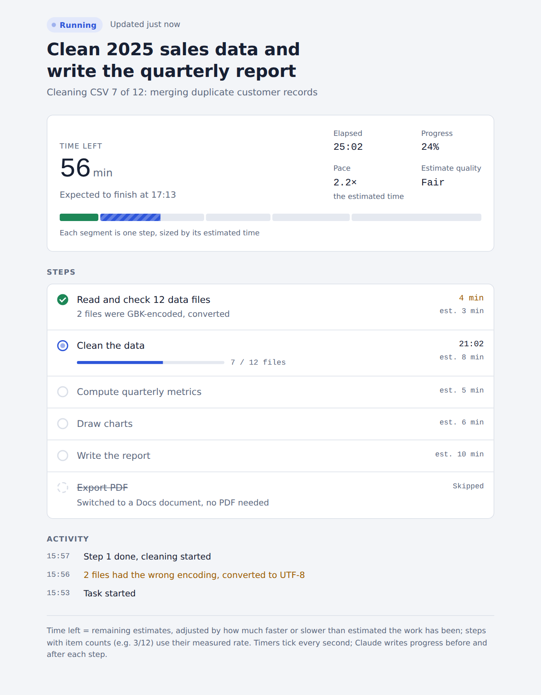
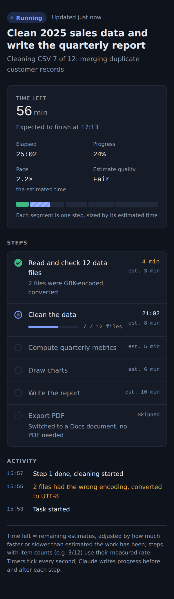

# Live Progress: a progress bar and ETA for Claude's long tasks

**English** | [简体中文](README.zh-CN.md)

   

When Claude works on a long task (research, batch file processing, a multi-section report), you usually can't tell how far along it is or how long it will take. **live-progress** is an [Agent Skill](https://github.com/anthropics/skills) that fixes that. At the start of a long task, Claude publishes a live progress page as an artifact. You can open it at any time to see:

- what Claude is doing right now
- every step, with its status and time taken
- a segmented progress bar, where each segment is sized by that step's estimated time
- time elapsed, **time left, and the expected finish time**
- a short activity log

**[▶ Try the live demo](https://bhu0345.github.io/claude-live-progress-skill/en/)** (simulated data, updates every few seconds)

<p>
  
  
</p>

## When Claude uses it

- Tasks it expects to take about 10 minutes or more, or with 6 or more steps.
- Whenever you ask for a progress bar, progress updates or an ETA.
- Say "no progress page" (or "不要进度页") and it skips the page for the rest of that conversation.

## How it works

```
Claude ──ArtifactData.update──▶ artifact database (run/state) ──live subscription──▶ progress page
        (once per checkpoint)                                                        (ticks every second)
```

- The page never writes anything. It subscribes to one document, `run/state`, in the artifact's database.
- Claude writes a small merge update at each checkpoint, usually when one step ends and the next begins. Only the changed fields are sent.
- The page does all the timing and ETA work itself, every second, from the timestamps Claude wrote.
- Right after publishing, Claude saves the page address in `progress-state.json` in its working directory. If its context is compacted in the middle of a long task, it reads that file and the page's current state, and carries on updating.

### How the ETA is estimated

1. Claude gives every step an estimate in minutes (`est`) when it plans the task.
2. The page learns a **pace** factor from real timings: actual time of finished steps ÷ their estimates. It also counts evidence from the running step, and uses a prior so one early outlier doesn't make the ETA swing.
3. Time left = what remains of the running step + remaining estimates × pace.
4. If a step processes many items (for example 7 / 12 files), its remaining time comes from the measured rate per item.
5. Time spent waiting for your reply doesn't count as work, so it doesn't stretch the estimate.
6. No update for 1.5 × the running step's estimate (at least 6 minutes) shows a warning. Three times that, and the page says the task **may have stopped**, instead of claiming it is still running.

## Install

### Claude app (claude.ai / desktop)

1. Download [`dist/live-progress.zip`](dist/live-progress.zip) (or the zip attached to the [latest release](https://github.com/bhu0345/claude-live-progress-skill/releases/latest)).
2. Go to **Customize → Skills → Add** and upload the zip. Code execution must be enabled. If you installed version 1.0, replace it with this one.
3. Start any long task. You can also ask for it directly: *"use live-progress to show progress"*.

### Claude Code

```bash
git clone https://github.com/bhu0345/claude-live-progress-skill
cp -r claude-live-progress-skill/live-progress ~/.claude/skills/
```

Copy the whole `live-progress` folder: the page template is a separate file next to `SKILL.md`.

## Where it works

The page needs artifacts with a database (`ArtifactData`). Where that's missing, Claude tracks the steps in its task list instead.

| Environment | Status |
|---|---|
| Claude Code cloud sessions | Tested with v1.1.0 (Oct 2026): page, live updates, waiting, recovery after context loss |
| Claude app, web chat | Not verified yet |
| Claude desktop app | Not verified yet |
| Claude Code in a terminal | No artifacts: falls back to the task list by design; not verified yet |

Tried it somewhere else? Please [open an issue](https://github.com/bhu0345/claude-live-progress-skill/issues) with what you saw.

## Is it working?

Soon after Claude starts a long task, a card titled "… progress" appears in the conversation, and Claude says the page is live. Open it: the header shows "Running" and "Updated just now", and the bar moves when a step finishes. The first open can stay blank for several seconds while the page connects.

## Troubleshooting

| What you see | What it means |
|---|---|
| No progress page appears | The task looked short, you said not to use it, or this environment has no artifact database. Ask for it directly, or check the table above. |
| Claude asks for approval before each progress update | Allow it permanently. If you decline, Claude turns live progress off for that task and uses its task list instead. |
| "No update for N min" | Claude is in a long step or waiting on a tool. It clears at the next checkpoint. |
| "May have stopped" | No update for a long time: the session may have ended or been interrupted. Check the conversation. |
| The page stays on "Running" after the task ended | Claude skipped its final update. Ask it to mark the page done. |

## Privacy and sharing

- The page shows what Claude writes to it: the task title, step names, notes and log lines. They are stored in the artifact's database in your Claude account.
- The page is private until you share it. Artifacts with a database can be shared inside your organization, not through a public link.

## What's in the repo

| Path | What it is |
|---|---|
| [`live-progress/SKILL.md`](live-progress/SKILL.md) | The instructions Claude follows: when to use the page, the data protocol, how often to update, how to recover (about 9 KB) |
| [`live-progress/template.html`](live-progress/template.html) | The progress page itself; Claude copies it for each task |
| [`dist/live-progress.zip`](dist/live-progress.zip) | Both files, packaged for upload to the Claude app |
| [`docs/`](docs/) | Standalone demo pages with a fake runtime, served on GitHub Pages |
| [`CHANGELOG.md`](CHANGELOG.md) | What changed in each version |

## Data format

One document at `run/state`:

```json
{
  "title": "Clean 2025 sales data and write the quarterly report",
  "lang": "en",
  "status": "running",
  "startedAt": 1790300000,
  "updatedAt": 1790300240,
  "activity": "Cleaning CSV 7 of 12",
  "steps": {
    "s01": {"n": 1, "title": "Read the data files", "est": 3, "status": "done", "startedAt": 1790300000, "endedAt": 1790300240},
    "s02": {"n": 2, "title": "Clean the data", "est": 8, "status": "running", "startedAt": 1790300240, "done": 7, "total": 12, "unit": "files"}
  },
  "log": {"1790300240": "Files read, cleaning started"}
}
```

`status` is one of `running`, `waiting` (Claude is waiting for your reply; `waitingSince` marks when), `done` or `failed`. Each step is `pending`, `running`, `done`, `failed` or `skipped`, and `pausedSec` records waiting time to leave out of its duration. Timestamps are Unix seconds; the page also accepts milliseconds and ISO strings. The full reference is in [`SKILL.md`](live-progress/SKILL.md).

## Cost and trade-offs

- Each checkpoint costs Claude one or two extra tool calls, so the skill is meant for tasks of about 10 minutes or more.
- Loading the skill adds about 9 KB of instructions, down from 35 KB in v1.0. The 26 KB page template is a separate file, used only when Claude publishes a page.
- Before any step finishes, the ETA rests only on Claude's own estimates, and the page labels it *Rough*. It gets better once real timings arrive.

## Contributing

Issues and PRs are welcome, especially results from environments not yet in the table, better estimation heuristics, more languages in the page, and screenshots from real runs.

If this skill helps you, a ⭐ helps other people find it.

## License

[MIT](LICENSE)
