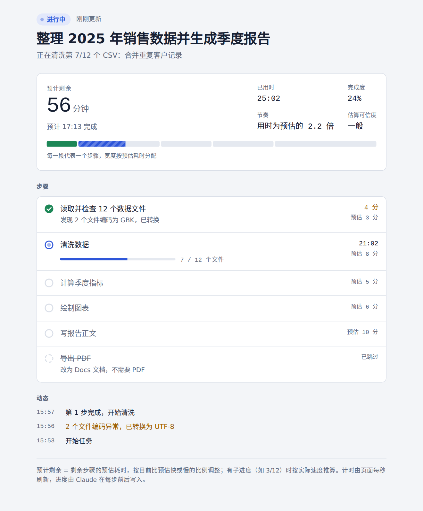
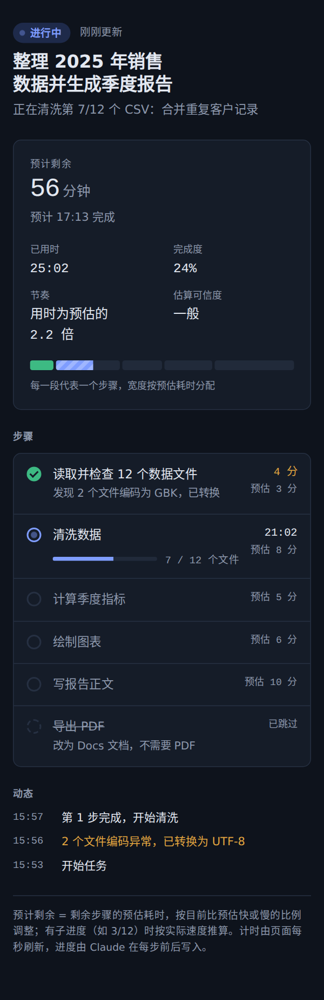

# Live Progress：给 Claude 长任务加上进度条和预计完成时间

[English](README.md) | **简体中文**

   

Claude 做长任务时（调研、批量处理文件、写多章节报告），你通常看不出它做到哪了、还要多久。**live-progress** 是一个 [Agent Skill](https://github.com/anthropics/skills)，用来解决这个问题。长任务一开始，Claude 会发布一个实时进度页（artifact），你随时点开就能看到：

- Claude 现在在做什么
- 每一步的状态和用时
- 分段进度条，每一段的宽度按该步骤的预估耗时分配
- 已用时、**预计剩余时间和预计几点完成**
- 关键节点的动态记录

**[▶ 在线演示](https://bhu0345.github.io/claude-live-progress-skill/)**（模拟数据，每隔几秒自动推进）

<p>
  
  
</p>

## Claude 什么时候用它

- 预计要 10 分钟左右或更久、或者有 6 个以上步骤的任务。
- 你要求显示进度条、进度或预计时间的时候。
- 说一句"不要进度页"（或 "no progress page"），这次对话剩下的部分就不再发布。

## 原理

```
Claude ──ArtifactData.update──▶ artifact 数据库 (run/state) ──实时订阅──▶ 进度页
         （每个检查点写一次）                                              （每秒刷新计时）
```

- 页面本身不写任何数据，只订阅 artifact 数据库里的一个文档 `run/state`。
- Claude 在检查点写一次合并更新，通常是一步结束、下一步开始的时候，只发送有变化的字段。
- 计时和预计剩余时间都由页面根据 Claude 写入的时间戳，每秒自己计算。
- 发布页面后，Claude 会把页面地址记在工作目录的 `progress-state.json` 里。长任务中途如果发生上下文压缩，它会读这个文件和页面的当前状态，接着更新。

### 预计时间怎么算

1. Claude 规划任务时，给每一步写一个预估分钟数（`est`）。
2. 页面用实际耗时学出一个**节奏**系数：已完成步骤的实际耗时 ÷ 预估耗时。进行中的步骤也算作证据，另外加了先验，所以前面某一步偏差很大时，预计时间不会大起大落。
3. 预计剩余 = 进行中步骤还剩的时间 + 剩余步骤的预估 × 节奏。
4. 某一步要处理很多项目时（比如 7 / 12 个文件），按每一项的实际处理速度推算这一步还要多久。
5. 等你回复的时间不算作工作时间，不会把预计时间拉长。
6. 超过当前步骤预估时间的 1.5 倍（至少 6 分钟）没有更新，页面会提示；超过这个时间的 3 倍，页面显示**可能已停止**，不会一直显示"进行中"。

## 安装

### Claude 应用（网页版 / 桌面版）

1. 下载 [`dist/live-progress.zip`](dist/live-progress.zip)（或[最新 release](https://github.com/bhu0345/claude-live-progress-skill/releases/latest) 里附带的 zip）。
2. 打开 **Customize → Skills → Add**，上传这个 zip。需要先开启代码执行。装过 1.0 版的，用这个版本替换掉。
3. 开始一个长任务即可。也可以直接说："用 live-progress 显示进度"。

### Claude Code

```bash
git clone https://github.com/bhu0345/claude-live-progress-skill
cp -r claude-live-progress-skill/live-progress ~/.claude/skills/
```

要复制整个 `live-progress` 文件夹：页面模板是 `SKILL.md` 旁边的单独文件。

## 在哪些环境能用

进度页需要带数据库的 artifact（`ArtifactData`）。没有这个能力的环境里，Claude 会改用自带的任务列表显示步骤。

| 环境 | 状态 |
|---|---|
| Claude Code 云端会话 | 已用 v1.1.0 实测（2026 年 10 月）：页面、实时更新、等待、上下文丢失后的恢复 |
| Claude 应用网页版对话 | 尚未验证 |
| Claude 桌面版 | 尚未验证 |
| 终端里的 Claude Code | 没有 artifact，按设计改用任务列表；尚未验证 |

在其他环境用过？欢迎[提 issue](https://github.com/bhu0345/claude-live-progress-skill/issues) 说说你看到的情况。

## 怎么确认它在工作

Claude 开始长任务后不久，对话里会出现一张"××进度"的卡片，Claude 也会说一句进度页已发布。点开后，顶部显示"进行中"和"刚刚更新"，每完成一步进度条就往前走。第一次打开时，页面可能空白几秒钟，这是在连接数据。

## 常见问题

| 你看到的情况 | 原因和处理 |
|---|---|
| 没有出现进度页 | 任务看起来不长、你说过不要，或者当前环境没有 artifact 数据库。可以直接要求它显示进度，或对照上面的环境表。 |
| 每次更新进度前都要你批准 | 选择始终允许。如果拒绝，Claude 会关闭这次任务的进度页，改用任务列表。 |
| "已 N 分钟没有新进度" | Claude 正在执行较长的一步，或在等某个工具返回。到下一个检查点就会恢复。 |
| "可能已停止" | 很久没有更新：会话可能已经结束或被打断。回对话里看看。 |
| 任务结束了，页面还显示"进行中" | Claude 漏了最后一次更新。让它把进度页标为完成。 |

## 隐私与分享

- 页面显示的是 Claude 写进去的内容：任务标题、步骤名、说明和动态记录。这些内容存在你 Claude 账户里这个 artifact 的数据库中。
- 页面默认只有你能看。带数据库的 artifact 只能在组织内分享，不能通过公开链接分享。

## 仓库内容

| 路径 | 说明 |
|---|---|
| [`live-progress/SKILL.md`](live-progress/SKILL.md) | Claude 照着执行的说明：什么时候用、数据协议、更新节奏、怎么恢复（约 9 KB） |
| [`live-progress/template.html`](live-progress/template.html) | 进度页本身，Claude 每个任务复制一份 |
| [`dist/live-progress.zip`](dist/live-progress.zip) | 上面两个文件，打包好用于上传到 Claude 应用 |
| [`docs/`](docs/) | 可以独立打开的演示页，用模拟数据代替 Claude 运行时（部署在 GitHub Pages） |
| [`CHANGELOG.md`](CHANGELOG.md) | 每个版本的改动 |

## 数据格式

只有一个文档 `run/state`：

```json
{
  "title": "整理 2025 年销售数据并生成季度报告",
  "lang": "zh",
  "status": "running",
  "startedAt": 1790300000,
  "updatedAt": 1790300240,
  "activity": "正在清洗第 7/12 个 CSV",
  "steps": {
    "s01": {"n": 1, "title": "读取数据文件", "est": 3, "status": "done", "startedAt": 1790300000, "endedAt": 1790300240},
    "s02": {"n": 2, "title": "清洗数据", "est": 8, "status": "running", "startedAt": 1790300240, "done": 7, "total": 12, "unit": "个文件"}
  },
  "log": {"1790300240": "数据读取完成，开始清洗"}
}
```

`status` 可取 `running`、`waiting`（等你回复，`waitingSince` 记录开始等待的时间）、`done`、`failed`。每一步的状态可取 `pending`、`running`、`done`、`failed`、`skipped`，`pausedSec` 记录这一步里要扣除的等待时间。时间戳用 Unix 秒，页面也接受毫秒和 ISO 字符串。完整字段说明见 [`SKILL.md`](live-progress/SKILL.md)。

## 代价和局限

- 每个检查点要多 1 到 2 次工具调用，所以只建议用在 10 分钟左右或更久的任务上。
- 加载这个 skill 只增加约 9 KB 的说明，1.0 版是 35 KB。26 KB 的页面模板是单独的文件，只在 Claude 发布页面时用到。
- 还没有步骤完成时，预计时间只能依据 Claude 自己的估算，页面会标为"粗略"。有了实际耗时后会越来越准。

## 参与贡献

欢迎提 Issue 和 PR，特别是这几方面：上面环境表里还没验证的环境的使用结果、更好的时间估算方法、页面的更多语言、真实任务的截图。

如果这个 skill 对你有用，点个 ⭐ 能让更多人看到它。

## 许可证

[MIT](LICENSE)
